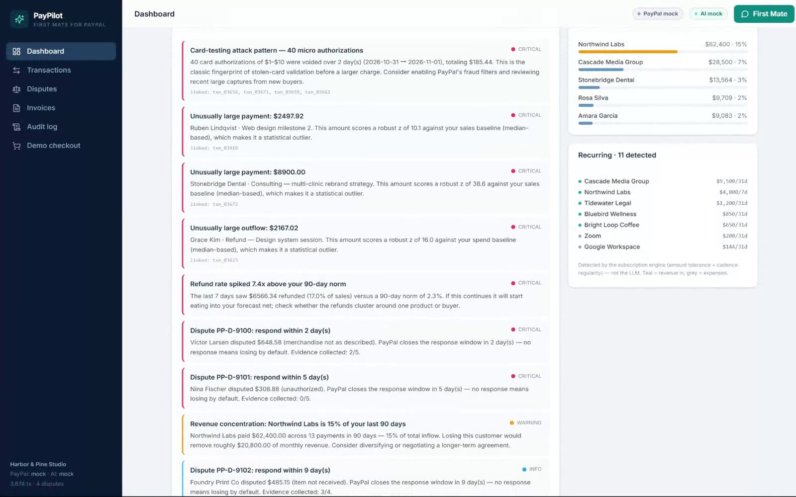
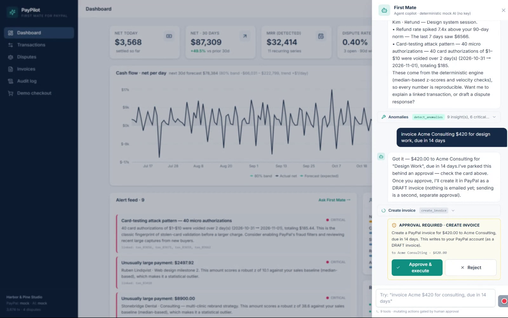
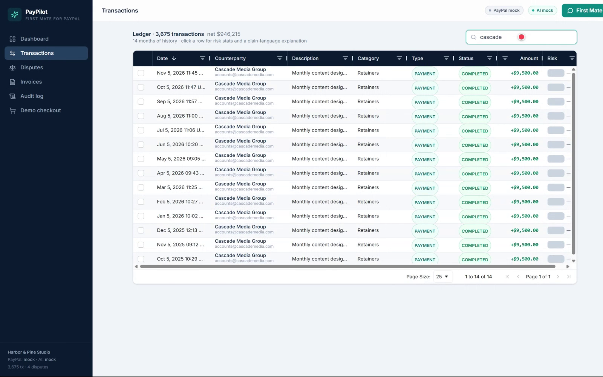
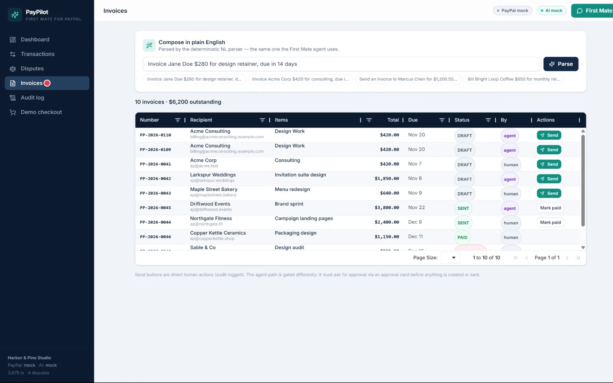

# PayPilot — the AI first mate for small merchants on PayPal




**First Mate proposes, a human approves:** natural-language invoice → approval card → executed & audited.



The ledger in AG Grid (quick filter + AI risk/category columns) and the invoice book:

| Transactions (AG Grid) | Invoices |
|---|---|
|  |  |

Small merchants on PayPal drown in their own ledger: disputes expire unnoticed, refunds quietly spike, one customer quietly becomes a third of revenue, and "will I be fine next month?" has no answer. PayPilot is an **agentic back office** that watches the account, surfaces money problems with real math, explains them in plain language — and, **only with your explicit approval**, takes actions like creating and sending invoices.

**The 60-second demo:** run it with zero credentials, ask First Mate *"what's happening with my money?"* and get a briefing with real numbers (net, anomalies, forecast) computed by a deterministic engine — not hallucinated. Then type *"invoice Acme $420 for consulting, due in 14 days"* and watch the full trust flow: parse → proposal → **approval card** → you approve → a real invoice is created (mock PayPal in demo, real Invoicing API v2 with sandbox creds) → every step lands in the audit log.

## Why it's different

1. **Human-in-the-loop agentic commerce.** The agent proposes; a human approves; every action is audit-logged. Mutating tools (`create_invoice`, `send_invoice`) physically cannot execute without a persisted, per-action approval. Trustable AI that touches money.
2. **Deterministic insight engine — not a chatbot wrapper.** Robust (MAD) z-score anomaly detection, card-testing pattern detection, weekday-seasonal forecasting with residual-based 80% bands, subscription detection, customer concentration, 0–100 explainable risk scoring. All pure, unit-tested functions. The LLM adds language and action; **the numbers come from auditable code** and work with zero API keys.
3. **Zero-config demo mode.** Mock PayPal + mock AI adapters behind the *same interfaces* as the real integrations, seeded with a story-driven 14-month ledger (~3,600 transactions: growth, weekly seasonality, holiday bump, 2 whale customers, a card-testing fraud burst, a refund spike, 3 disputes with live deadlines). Judges clone-and-run in 3 minutes; every code path is the real integration when credentials are provided.

## Quickstart (3 commands)

```bash
npm install
npm run build
npm start            # → http://localhost:5075  (zero env vars; mock PayPal + mock AI)
```

The server **auto-seeds demo data on first boot** (mock mode). To regenerate explicitly: `npm run seed`.

Other useful commands:

| Command | What it does |
| --- | --- |
| `npm test` | Vitest suite — 49 assertions-level tests across 8 files |
| `npm run lint` | ESLint (flat config, typescript-eslint) |
| `npm run dev` / `npm run dev:web` | API with watch / Vite dev server (proxies `/api`) |
| `docker build -t paypilot . && docker run -p 5075:5075 paypilot` | Containerized (multi-stage, healthchecked) |

## Going live with the PayPal sandbox

1. Create a REST app at <https://developer.paypal.com/dashboard/applications/sandbox> → copy the **Client ID** and **Secret**.
2. `cp .env.example .env` and fill in:
   ```
   PAYPAL_ENV=sandbox
   PAYPAL_CLIENT_ID=AV...your_client_id
   PAYPAL_CLIENT_SECRET=EH...your_secret
   PAYPAL_MERCHANT_EMAIL=you@business.example
   ```
3. `npm start` — transactions, invoices, disputes and the demo checkout now hit the **real** `api-m.sandbox.paypal.com` through the same provider interface (`src/server/paypal/sandbox.ts`, OAuth2 in `client.ts`).
4. Optional AI upgrade — pick any provider, no code changes:
   ```
   AI_PROVIDER=openai            # openai | anthropic | gemini (any OpenAI-compatible base URL works)
   AI_API_KEY=sk-...
   AI_MODEL=gpt-4o-mini
   # AI_BASE_URL=https://api.deepseek.com/v1   # DeepSeek/Groq/OpenRouter/Ollama
   ```

The demo checkout page creates a real Order (Orders API v2), lets the sandbox buyer approve it, and captures the payment — live integration proof in 20 seconds.

## Architecture

```
┌──────────────────────────────  Browser (React 18 SPA)  ──────────────────────────────┐
│  Dashboard (Recharts + forecast band)   Transactions (AG Grid)   Disputes  Invoices  │
│  Audit log (AG Grid)  Demo checkout     First Mate chat drawer (SSE: token/tool_call │
│                                         /tool_result/approval_request/done/error)    │
└───────────────────────────────────────┬──────────────────────────────────────────────┘
                                        │ REST + SSE (/api/*)
┌───────────────────────────────────────▼──────────────────────────────────────────────┐
│  Fastify server (TypeScript, Node 24)                                               │
│  ┌─────────────┐   ┌──────────────────────┐   ┌────────────────────────────────────┐ │
│  │ Agent       │   │ Insight engine (pure)│   │ PayPal layer                       │ │
│  │ providers:  │   │ • anomaly (MAD z)    │   │ provider.ts  ← one interface       │ │
│  │ mock/openai/│→  │ • forecast (trend ×  │   │ ├ mock/   seeded, in-memory       │ │
│  │ anthropic/  │   │   weekday season)   │   │ ├ sandbox (OAuth2 REST: invoicing  │ │
│  │ gemini      │   │ • subscriptions     │   │ │   v2, orders v2, disputes, txns) │ │
│  │ tools.ts (9)│   │ • categorize / risk │   │ └ seed.ts (14-month story, PRNG)   │ │
│  │ approvals ←──┼── human-in-the-loop    │   └────────────────────────────────────┘ │
│  └─────────────┘   └──────────────────────┘   Store: data/state.json (atomic JSON)   │
└──────────────────────────────────────────────────────────────────────────────────────┘
```

- **One npm package**, TypeScript strict everywhere, shared types in `src/shared/types.ts`, no native modules, no database.
- **Provider pattern:** `MockPayPalProvider` and `SandboxProvider` implement the same `PayPalProvider` interface; services take a provider, never a client.
- **Agent runtime:** 9 tools with strict JSON schemas; mutating tools are gated behind persisted approvals (`src/server/agent/approvals.ts`); every action is written to the audit log (`/api/audit`, Audit page).

## Agent safety — human-in-the-loop

- **Read-only tools execute immediately** and stream result cards into chat (search, summaries, forecasts, anomaly detection, dispute listing/drafting, transaction explanations).
- **Mutating tools never execute inline.** `create_invoice` / `send_invoice` create a *pending approval* (persisted, survives restarts) and render an approval card with a plain-language rationale of exactly what will happen. Nothing touches PayPal until a human clicks **Approve**.
- **Approving executes the real action** against the active provider and records three audit entries: the request (`pending`), the decision (who approved), and the outcome (`ok`/`error`) — visible on the Audit page with full arguments.
- **Rejecting executes nothing** and is logged too.
- The system prompt forbids the agent from ever claiming an action completed before approval; dispute *responses* are drafted locally only — submitting to PayPal stays a manual step outside the app.

## Screens

1. **Dashboard** — KPI cards (net today/30d, MRR, dispute rate, critical alerts), cash-flow chart with 80% forecast band, alert feed, concentration + recurring panels.
2. **Transactions** — AG Grid ledger: quick filter, column/set/number/date filters, status chips, risk badges, custom cell renderers, detail drawer with deterministic "explain this".
3. **Disputes** — deadline countdowns, evidence checklists, one-click AI-drafted responses.
4. **Invoices** — natural-language composer (parse → preview → create → send) plus an AG Grid with status chips and row actions.
5. **First Mate** — chat drawer on every page: streaming answers, tool cards, approval cards.
6. **Audit log** — every agent action, human decision, and system event with full arguments.
7. **Demo checkout** — Orders API v2 create → approve → capture, proving the live integration path.

## Feature → judging criteria map

| Criterion | Where PayPilot delivers |
| --- | --- |
| **Best use of PayPal APIs** | Real Invoicing v2 / Orders v2 / Disputes / Transactions-search service layer behind a provider interface; demo checkout proves the flow end-to-end; sandbox mode is one env flip away |
| **AI / agent quality** | Function-calling loop with 9 JSON-schema tools, streaming SSE UX, intent routing that works keyless (deterministic mock) and with OpenAI/Anthropic/Gemini-compatible providers |
| **Trust & safety** | Human-in-the-loop approvals for every mutating action, persisted + audit-logged; deterministic math (no hallucinated numbers) |
| **Design & UX** | Professional SaaS UI: AG Grid themed grids, Recharts forecast band, skeletons, empty states, toasts, approval cards |
| **Real-world usefulness** | Fraud bursts, dispute deadlines, refund spikes, concentration risk — problems actual merchants lose money to, detected by auditable code |
| **Working software** | Clone → `npm install && npm run build && npm start` → full product with seeded data, zero credentials; 49 tests; CI on 2 OS × 2 Node versions; Dockerfile + render.yaml |

## Repository layout

```
src/shared/          types + pure utils (used by server AND web)
src/server/          Fastify: config, context, routes/ (REST + SSE chat)
src/server/paypal/   client (OAuth2), services/ (REST), mock/, sandbox, seed generator
src/server/insights/ anomaly, forecast, categorize, subscriptions, risk  (pure functions)
src/server/agent/    runtime, tools (JSON schemas), approvals, parser, drafts, providers/
src/server/store/    JSON file store with atomic writes
src/web/             React SPA: pages/, components/, lib/, state/
tests/               vitest suites (engine math, parser, tools, mock provider, agent loop)
scripts/seed.ts      regenerate data/state.json
```

## License

MIT — see [LICENSE](LICENSE).
